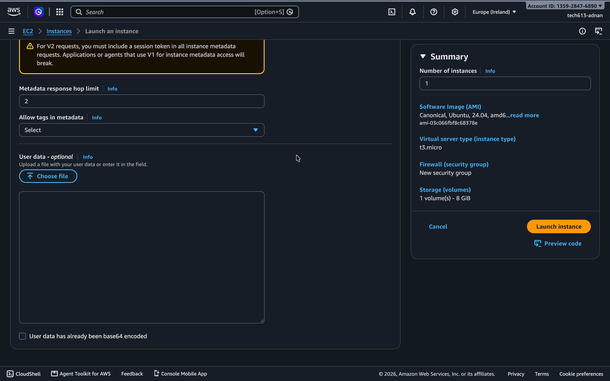
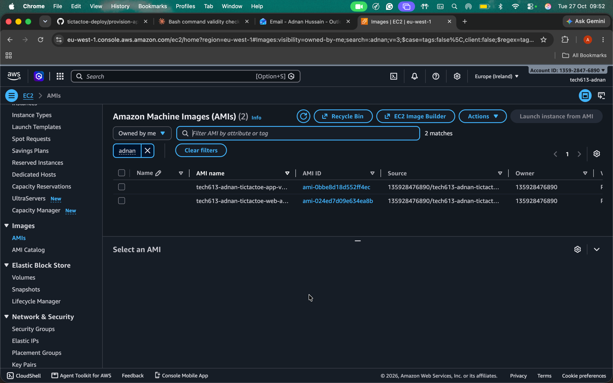
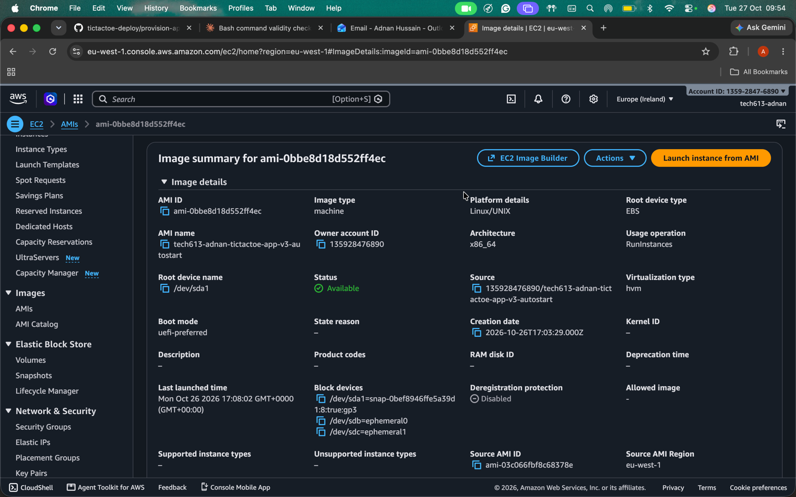

# Automating the web app launch
## Creating a bash script
- This bash script was created and can be ran on the terminal via
```text
chmod +x provision-app.sh
./provision-app.sh
```
- The following code assumes you have the zip file in a girhub repo, the one I will be using is https://github.com/Adnan-SpartaGlobal/tictactoe-deploy.git
```text
#!/bin/bash
# Update and upgrade
sudo apt update
sudo apt upgrade -y

# Install all relevant packages
sudo apt install unzip nginx git -y

# Download the NodeSource setup script for Node.js 20.x
# and  save it in the file nodesource_setup.sh
curl -sL https://deb.nodesource.com/setup_20.x -o nodesource_setup.sh

# Run the NodeSource setup file with administrator privileges
sudo bash nodesource_setup.sh

# Install the relevant version of Node.js and pm2
sudo apt install nodejs -y
sudo npm install -g pm2

# Fresh clone each run so re-runs are safe
cd ~
rm -rf tictactoe-deploy
git clone https://github.com/Adnan-SpartaGlobal/tictactoe-deploy.git
cd tictactoe-deploy

# Unzip and run the app only if the zip file exists
if [ -f nodejs20-sparta-tictactoe-v1.zip ]; then
    unzip -o nodejs20-sparta-tictactoe-v1.zip
    cd app
    npm install

    # Remove any existing tictactoe web-apps  process 
    # so re-runs don't create duplicates. If there are no 
    # existing processes, then carry on via || true.
    pm2 delete tictactoe || true

    # Start the app and call it tictactoe
    pm2 start index.js --name tictactoe

    pm2 startup systemd -u root --hp /root
    pm2 save

    # Reverse proxy: replace nginx's file-serving line with a proxy to the app.
    # On re-runs the line is already gone, so sed changes nothing.
    sudo sed -i 's|try_files \$uri \$uri/ =404;|proxy_pass http://localhost:3000;|' /etc/nginx/sites-available/default

    # Check the config is valid, and only reload nginx if it is
    sudo nginx -t && sudo systemctl reload nginx         

else
    echo "Cannot find zip file needed"
fi
```
## Remove the need to use ssh entirely
- No need to even get into the Ubuntu VM at all!
- All we need to do is create a new instance and put our code in **User data**
- Click **Launch instance**, wait for a bit and then the web app should deploy itself




## Using Images to make things faster
Click on:
- Actions -> Image and Templates -> Create Image
- Enter relevant details and hit Create Image
- Go to AMIs under Images and click on your AMI ID



- Launch Instance from AMI


- Click on your AMI under My AMIs


- Use your security group and appropriate network settings
- Optional: Add User Data
- Launch Instance

### Important things to consider for images
- **Note:** Image doesn't need user data due to the instance having the following lines of code:
```text
pm2 startup systemd -u root --hp /root
pm2 save
```
- So image runs on startup without User Data