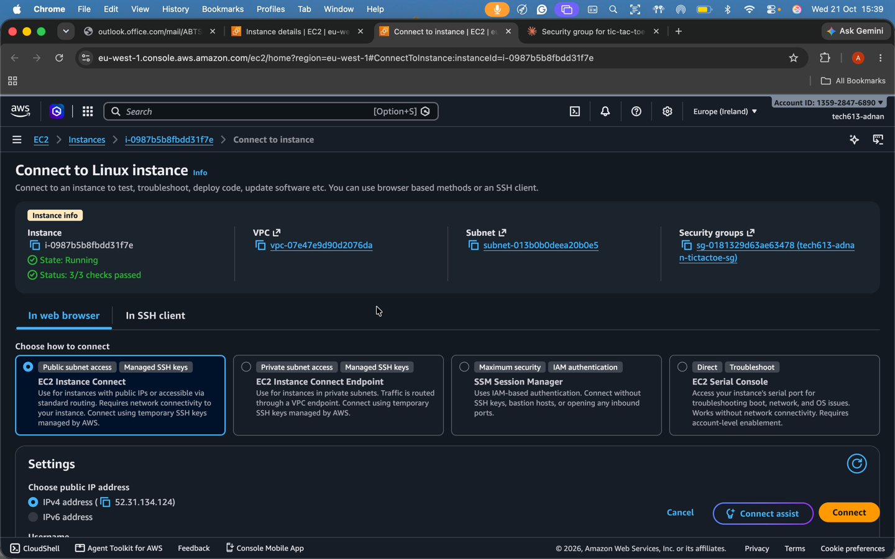
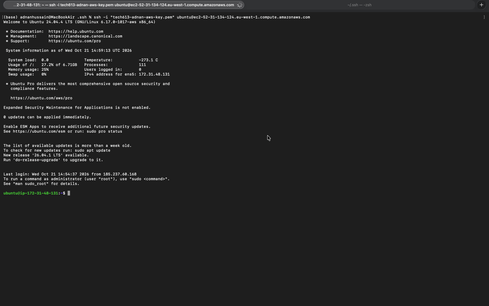

# Deploying the website
## 1. AWS set up
- Log into AWS
- Search for **EC2** --> **Launch Instances**
- Click on Ubuntu and select:
```text
Ubuntu Server 24.04 LTS (HVM), SSD Volume Type
ami-04df7d76c1b804451 (64-bit (x86)) /ami-006226dd084c60847 (64-bit (Arm))
Virtualization: hvm ENA enabled: true Root device type: ebs
```
- Select **confirm changes**
- Keep instance type to **t3.micro** as the web app we are running is lightweight
- Enter your key pair name
- On **network settings** click **edit**
- Select **Create new security group**
- Give the security group an appropriate name and description
  - Name: tech613-adnan-tictactoe-sg
  - Description: Allows SSH (22), HTTP (80) and app traffic (3000) for the tic-tac-toe web app
- Add in all relevant security groups, ensure they receive a connection from anywhere via `0,0,0,0/0`:
  - ssh [port: 22] --> needed to use security keys in ssh folder
  - HTTP [port: 80] --> So we can actually display the website online
  - Custom TCP [port: 3000] --> Port we will use when typing in the link
    - **Note:** The custom TCP port is not exclusive to this number but code in the web app hard sets this as 3000 hence port 3000 is used
- **DOUBLE CHECK EVERYTHING** then press **Launch instance**


### Automation Stage 2


## 2. `ssh` set up
- On AWS website, click on **connect**
- On the terminal, run the following to enter into the hidden `.ssh` folder
```text
cd .ssh
```
- If not done at leat once before, run 
```text
chmod 400 "tech613-adnan-aws-key.pem"
```
## 3. Transfer zip file from local machine to VM
- Download the zip file
- Then run the command
```text
scp -i "<your-key-name>.pem" /path/to/<your-app>.zip ubuntu@<ec2-public-dns>:~/
```
### What does this mean
* `scp` starts a secure copy over SSH
* `-i "<your-key-name>.pem"` tells it which private key to log in with
* `/path/to/<your-app>.zip` is the file on your local machine to upload
* `ubuntu@<ec2-public-dns>` is the login user and the instance's public DNS name
* `:~/` is the destination, the `ubuntu` user's home directory on the VM
* scp connects, authenticates with the key, and copies the zip across
* The file is uploaded only. It is not unzipped

## 3. Get into Linux VM
- Run the following to connect your local machine to the VM instance that is already running:
```text
ssh -i "your-private-key-pair.pem" your_SSH_connection_address
```
- **Note:** Replace `your-private-key-pair.pem` with your own `.pem` file and `your_SSH_connection_address` with the one shown on AWS website

- **Note:** You might need to type in **yes**
## 4. Linux set up
- Install all updates (do this when creating a new VM)
```text
sudo apt update -y
```
- **Note:** `-y` automatically answers yes for any yes/no questions asked
- Then Upgrade to make sure the things intsalled in update are actually online (do not do this on pre-existing set ups)
```text
sudo apt upgrade -y
```
- Install all relevant packages
```text
sudo apt install unzip nginx -y
```
- Unzip the file
```text
sudo unzip nodejs20-sparta-tictactoe-v1.zip
```
- Then run,
```text
curl -sL https://deb.nodesource.com/setup_20.x -o nodesource_setup.sh
```
- downloads the NodeSource setup script for Node.js 20.x and saves it to a local file named nodesource_setup.sh
- It **does not** install Node.js yet

| Part                                    | Meaning                                                                                              |
| --------------------------------------- | ---------------------------------------------------------------------------------------------------- |
| `curl`                                  | Fetches data from a URL.                                                                             |
| `-s`                                    | Silent mode; suppresses progress output.                                                             |
| `-L`                                    | Follows HTTP redirects.                                                                              |
| `https://deb.nodesource.com/setup_20.x` | The URL of the NodeSource setup script for Node.js 20.x.                                             |
| `-o nodesource_setup.sh`                | Saves the downloaded content to a file named `nodesource_setup.sh` in the current working directory. |

- Run the NodeSource setup file with administrator privileges
```text
sudo bash nodesource_setup.sh
```
- Install the relevant version of nodejs
```text
sudo apt install nodejs -y
```
- Finally run
```text
npm install ; npm start
```

## 5. Open website
- Now run
```text
http://<your_public_address>:3000/
```


